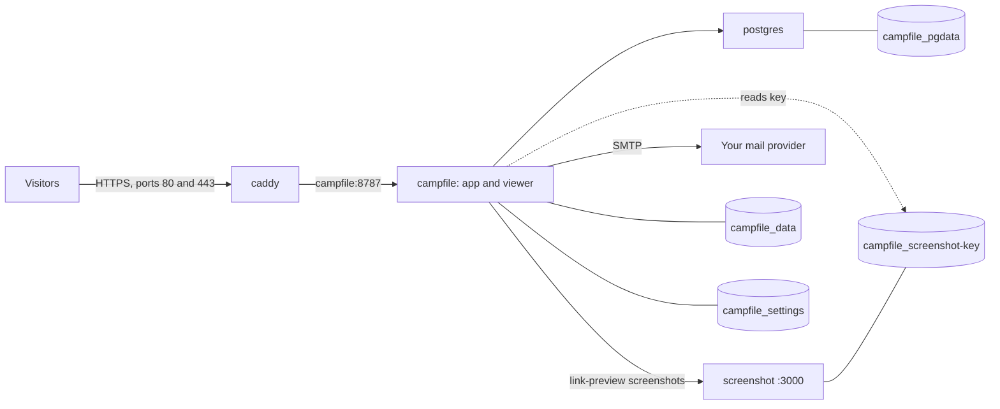
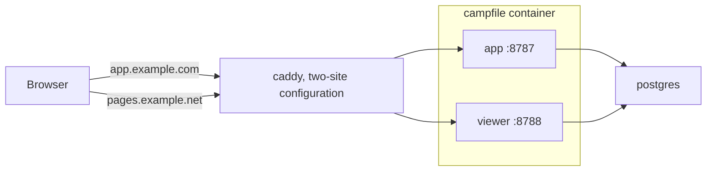
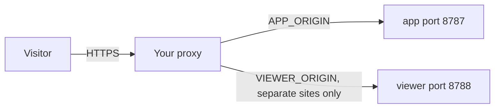
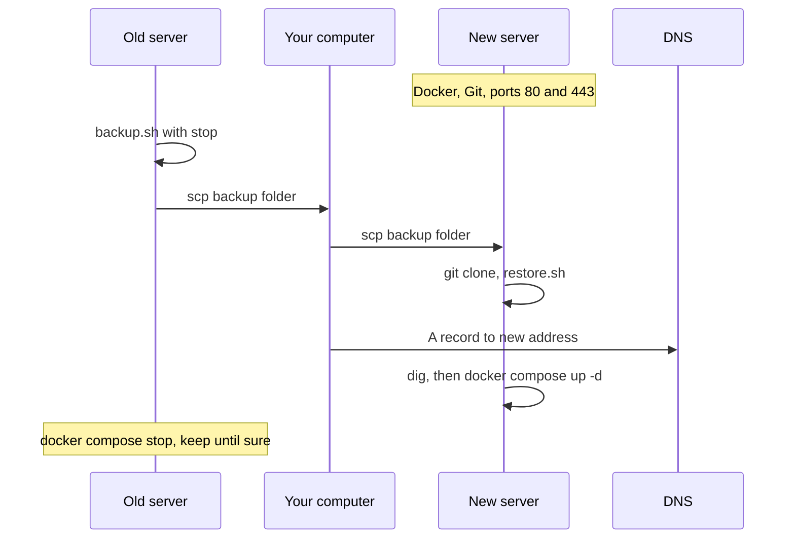

# Advanced Campfile hosting

Start with [Run your own Campfile](DEPLOY.md); the default installation needs none of this.

## Contents

| Section | Covers |
|---|---|
| [How the pieces fit](#how-the-pieces-fit) | Overview |
| [Hosting other people's accounts](#hosting-other-peoples-accounts) | Open sign-up, per-account quotas, email caps |
| [Separate viewer site](#separate-viewer-site) | Untrusted users |
| [External Postgres](#external-postgres) | Your own database |
| [Custom reverse proxy](#custom-reverse-proxy) | Your own proxy |
| [Network and resource boundaries](#network-and-resource-boundaries) | Firewall, request size and rate limits, [screenshots](#link-preview-screenshots) |
| [Data, recovery and secret changes](#data-recovery-and-secret-changes) | [Restore](#restore-a-backup), [move](#move-to-a-new-server), [undo](#undo-a-restore), [upgrades](#upgrades-and-retention), [secrets](#settings-and-secrets) |
| [Limits of a self-hosted install](#limits-of-a-self-hosted-install) | What a self-hosted install lacks |
| [Settings reference](#settings-reference) | Every `.env` setting and its default |
| [Admin](#admin) | Accounts, takedowns, SQL |
| [Check a deployment](#check-a-deployment) | After install, upgrade, proxy change |

## How the pieces fit

Default `https` profile, one address for app and viewer:



| Container | Reachable at | Notes |
|---|---|---|
| `caddy` | `0.0.0.0:80`, `0.0.0.0:443` TCP and UDP (IPv4 only) | Only with `COMPOSE_PROFILES=https`; fixed address `172.29.88.254` on subnet `172.29.88.0/24` |
| `campfile` | `127.0.0.1:8787` on the host | 1 GB memory limit |
| `postgres` | not published | 200 connections |
| `screenshot` | not published | Only `campfile` reaches it, on network `shots` |

A [separate viewer site](#separate-viewer-site) adds port 8788; a [custom proxy](#custom-reverse-proxy) replaces `caddy`.

A **connector** is an AI app (Claude, ChatGPT) linked to a workspace through `<APP_ORIGIN>/mcp` with OAuth; its state lives in `campfile_data` (`oauth-kv`).

## Hosting other people's accounts

> [!WARNING]
> Sign-up is open: anyone who receives a sign-in code can create a workspace. There is no invite-only switch or account-count cap.

| Limit | Value |
|---|---|
| Storage of active pages per standard account | 100 MB: a quota, not a disk ceiling (taken-down pages remain stored) |
| Pages per standard account | 200 |
| New pages per standard account | 50 a day |
| Requested emails, all visitors | 1,500 a day; admin new-account/page notices are outside this cap |
| Requested emails per visitor IP | 20 a day |
| Sign-in codes per email | 5 an hour |

Budget disk for Postgres, retained pages, connector state, backups.

1. Configure outgoing email and `ADMIN_EMAIL` (receives new-account and new-page notices).
2. Monitor delivery failures and your provider's quota.
3. Handle abuse with `pnpm admin takedown` and `disable-tester` (a tester is an account: [Admin](#admin)).

### Outgoing email settings

| Setting | Behaviour |
|---|---|
| `SMTP_PORT=465` | TLS immediately |
| Other `SMTP_PORT` | STARTTLS; needs a valid certificate for `SMTP_HOST` |
| `SMTP_USER`, `SMTP_PASSWORD` | Both, or neither for an unauthenticated relay |
| `SMTP_HOST` empty | No email is sent; messages go to `docker compose logs campfile`. That log then holds sign-in codes: treat it as secret |

### Your terms, privacy, pricing and support pages

Campfile ships none of these, no `/.well-known/security.txt`, and links to none. To add yours:

1. Put them in `public/` as `terms.html`, `privacy.html`, `pricing.html` and `support.html`: fragments like `docs.html`, wrapped in Campfile's header and footer.
2. In `src/hosted.ts`:

   | Name | Set to |
   |---|---|
   | `OWN_PAGES` | Your pages, for their footer links |
   | `FOOTER_NOTE` | The footer's last line (who runs the site) |
   | `OWN_CSS` | Your pages' styles |
   | `HAS_TERMS` | `true` once `/terms` and `/privacy` exist: code screens, emails and the reader's consent box then say continuing accepts them |

3. The consent box links to `/privacy#sharing`: give that section the id `sharing`.
4. Change `TERMS_VERSION` in `src/signin.ts` (not a setting) when your terms change; terms acceptance uses it.
5. Adapt `public/docs.html` to your install; set your contact and sender address.
6. Commit local changes before upgrading, so `git pull --rebase` replays them.

## Separate viewer site

Serves pages from a second registrable domain, so browsers treat them as a different site from the app.



| | One address (default) | Separate viewer site |
|---|---|---|
| Origins | `APP_ORIGIN`; `VIEWER_ORIGIN` empty | Both, on different registrable domains |
| Loopback ports | 8787 | 8787 app, 8788 viewer |
| Caddy configuration | `Caddyfile` | `Caddyfile.separate` |
| Isolation | Opaque-origin sandbox | Sandbox plus a separate browser site |

1. Point both DNS A records directly to this server.
2. In `.env`:

   ```dotenv
   APP_ORIGIN=https://app.example.com
   VIEWER_ORIGIN=https://pages.example.net
   COMPOSE_PROFILES=https
   COMPOSE_FILE=compose.yaml:compose.separate.yaml:compose.override.yaml
   ```

   Leave out `:compose.override.yaml` if that file does not exist. Once `COMPOSE_FILE` is set, Compose no longer loads that file by itself, and every later Compose command uses these files. `COMPOSE_FILE` uses `:` on Linux/macOS, `;` on Windows.

3. Start it. The build puts the two-site Caddy configuration into the Caddy image:

   ```sh
   docker compose up -d --build
   ```

> [!NOTE]
> Two subdomains of `example.com` are the same browser site. Related hostnames are refused or warned about at startup; verify the shared suffix against the Public Suffix List.

> [!WARNING]
> Do not remove the opaque-origin sandbox in either mode.

## External Postgres

| Requirement | Why |
|---|---|
| Postgres 17, reachable from the container | — |
| `DATABASE_URL`: the **direct**, not pooled, owner connection string | The owner creates/alters roles and tables |
| At least 200 connections | The app admits 150 requests at once |
| A host other than `localhost` | Inside the container, `localhost` is the container itself |
| One Campfile installation per PostgreSQL server | Every app start changes the server-wide `campfile_app` role's password, disconnecting other installations using it |

Migrations and `docker compose exec campfile pnpm admin …` use the owner connection; serving uses the restricted `campfile_app` role.

1. Create an empty database and its owner role on your Postgres 17.
2. Add this line to `selfhost/.env`:

   ```dotenv
   DATABASE_URL=postgres://<owner>:<password>@<host>:5432/<database>
   ```

   - No quotes around it: `docker run --env-file`, used under [Admin](#admin), would keep them.
   - Percent-encode special characters in the password: `$` becomes `%24`, so `pa$s` is `pa%24s`.
   - No `${…}` substitutions.
   - Postgres on this host: `<host>` is the bridge gateway `172.29.88.1`, and Postgres must listen there.
3. Run `docker compose up -d`. Migrations run at start.

> [!WARNING]
> Do not run `selfhost/app-role.ts` manually against a running installation: it rotates that role's password. Maintenance commands load generated settings without rotating it.

### Back up an external database

With `DATABASE_URL` set, the bundled Postgres still starts, unused, and `backup.sh` refuses to run. Every command below runs in `selfhost/`.

1. Back up the code revision, database, settings, page files and `.env` into a private folder outside the checkout:

   ```sh
   (
     set -e
     umask 077
     b=~/campfile-backup/$(date +%Y%m%d-%H%M%S)   # private, outside the checkout
     mkdir -p "$b"
     git rev-parse HEAD > "$b/revision"
     # start it again at the end, even after a failure, only if it was running: one stopped on purpose stays stopped
     if docker compose ps --status running --services | grep -qx campfile; then trap 'docker compose start campfile' EXIT; fi
     docker compose stop campfile
     docker run --rm --network campfile_default --env-file .env postgres:17-trixie sh -c 'exec pg_dump -Fc "$DATABASE_URL"' > "$b/database.dump"
     docker compose run --rm --no-deps -T --entrypoint tar campfile -C / -cf - settings data > "$b/files.tar"
     cp .env "$b/env"
     if [ -f compose.override.yaml ]; then cp compose.override.yaml "$b/"; fi
     echo "Saved in $b"
   )
   ```

   It stops at the first failed step and then prints no `Saved`. Campfile starts again only if it was running before. The folder holds your passwords: keep it private and copy it off this server.

### Restore an external database

Run every command in `selfhost/`, in one terminal. First name the backup folder: replace `<folder name>` with the last part of the path the backup printed after `Saved in`. Then check it: `ls "$b"` must list `revision`, `database.dump`, `files.tar` and `env`.

```sh
b="$HOME/campfile-backup/<folder name>"
ls "$b"
```

1. Stop the app, save its current settings and page files to a private folder, then delete those two volumes. Untarring over them would keep files made after the backup, sign-ins and connector logins included:

   ```sh
   docker compose down
   keep=~/campfile-backup/replaced-$(date +%Y%m%d-%H%M%S) && (umask 077 && mkdir -p "$keep") &&
   docker run --rm -v campfile_data:/v/data -v campfile_settings:/v/settings postgres:17-trixie tar -C /v -cf - . > "$keep/volumes.tar" &&
   docker volume rm campfile_data campfile_settings
   ```

2. Move the checkout to the backup's code (it must have no uncommitted changes):

   ```sh
   git reset --hard "$(cat "$b/revision")"
   ```

3. Move the current `.env` and override file aside, then put back the backup's. With no override in the backup, none stays active:

   ```sh
   now=$(date +%Y%m%d-%H%M%S)
   for f in .env compose.override.yaml; do [ ! -f "$f" ] || mv "$f" "$f.before-restore-$now"; done
   cp "$b/env" .env
   [ ! -f "$b/compose.override.yaml" ] || cp "$b/compose.override.yaml" .
   ```

4. Create a **new empty database** and point `DATABASE_URL` in `.env` at it. Never import an older dump over a newer schema.
5. Build, and create the containers, network and volumes without starting them:

   ```sh
   docker compose build && docker compose create
   ```

6. Put back the settings and page files:

   ```sh
   docker run --rm -i --user 0 -v campfile_settings:/settings -v campfile_data:/data --entrypoint tar campfile-selfhost -C / -xf - < "$b/files.tar"
   ```

7. Create the schema and the `campfile_app` role, then load the dump over it:

   ```sh
   docker compose run --rm --no-deps -T campfile pnpm migrate &&
   docker run --rm -i --network campfile_default --env-file .env postgres:17-trixie sh -c 'exec pg_restore --clean --if-exists --no-owner --single-transaction --exit-on-error -d "$DATABASE_URL"' < "$b/database.dump"
   ```

8. Redo what was closed since the backup ([Before opening traffic](#before-opening-traffic)). For the SQL there, use the **Your own Postgres** command under [Admin](#admin) in place of `docker compose exec postgres psql -U campfile campfile`. Then start it:

   ```sh
   docker compose up -d --build
   ```

## Custom reverse proxy

Your own proxy instead of the bundled Caddy:



1. Leave `COMPOSE_PROFILES` empty, not `https`. If Caddy runs, `docker compose stop caddy` frees its ports.
2. Forward each origin to its port. HTTP is allowed only on localhost; public origins require HTTPS.
3. Set `TRUSTED_PROXIES` to the proxy's exact address **as the container sees it**.
4. The proxy must replace `X-Forwarded-For` with the client address; no other client header changes who Campfile takes it to be.
5. Run the [visitor-address check](#check-a-deployment), not just an availability check: rootless/Desktop forwarding may hide visitor addresses.

| Proxy runs | Forward to | `TRUSTED_PROXIES` | Also |
|---|---|---|---|
| Bundled Caddy | (preset) | `172.29.88.254` | — |
| On this host | `127.0.0.1:8787` (separate sites also `127.0.0.1:8788`) | Usually the bridge gateway `172.29.88.1` | — |
| In a container | `campfile:8787` (and `campfile:8788`), not host loopback | Its fixed address, such as `172.29.88.253` | Join `campfile_default`; publish proxy ports on IPv4 only |
| On another machine | A private bind address, or `BIND_ADDRESS=0.0.0.0` | Its address as the container sees it | Firewall allows **only that proxy** to the app ports; private network or encrypted tunnel |

- An explicitly empty `TRUSTED_PROXIES` trusts nobody. Never trust a whole private network.
- A CDN in front of bundled Caddy combines visitors under CDN addresses and their shared limits.

> [!WARNING]
> Docker-published ports can bypass UFW: use the cloud firewall or `DOCKER-USER`. Never expose the plain-HTTP app ports publicly.

### nginx

- `proxy_set_header X-Forwarded-For $remote_addr;`
- `client_max_body_size 33m;`
- `client_header_timeout 10s;`
- `client_body_timeout 30s;`
- HSTS
- `access_log off; error_log /var/log/nginx/error.log crit;`: query strings contain login links, invites and view tickets.
- Upstream idle time below Campfile's 125 seconds.

The supplied Caddy configuration already avoids those logs and sets timeouts.

### Change the Docker subnet

If `172.29.88.0/24` clashes, override the subnet and Caddy's fixed address together in `compose.override.yaml` (Compose 2.24.4+):

```yaml
services:
  caddy:
    networks:
      default:
        ipv4_address: 10.77.0.254
networks:
  default:
    ipam:
      config: !override
        - subnet: 10.77.0.0/24
```

Set `TRUSTED_PROXIES=10.77.0.254`; the host gateway becomes `10.77.0.1`.

## Network and resource boundaries

### Outbound

A `source_url` (an address an AI gives instead of a page's HTML), or a redirect, to any of these is refused with "Could not download":

- loopback or a private network
- cloud metadata (`169.254.169.254`)
- this server's addresses, found at startup from the origin names (restart after their DNS changes)

Only Campfile's own origins are exempt (list in `selfhost/server.ts`, enforced by `selfhost/outbound.ts`).

> [!WARNING]
> Never allow-list this server's address on another service: any user can make Campfile fetch from it.

The built-in block covers only the addresses the origin names resolved to at startup, not every address of this host.

| Your setup | Firewall recipe |
|---|---|
| Bundled Caddy, or a proxy on this host; one public address; no `does not resolve` warning at startup | Not needed |
| Proxy on another machine (the names resolve to the proxy) | Needed |
| This server has a second public address | Needed |
| Startup log has a `does not resolve` warning | Needed, and fix the DNS |

A recipe blocks new connections from the Docker subnet to the host in `INPUT` (`DOCKER-USER` sees only forwarded traffic). Use **one**; substitute your subnet.

| This server has | Use |
|---|---|
| Active UFW (`Status: active`) | [UFW recipe](#ufw-recipe) |
| No UFW or other firewall manager | [iptables recipe](#iptables-recipe) |
| Inactive UFW | Not protection: configure and activate it safely first, or deliberately remove it and use iptables |

#### UFW recipe

1. `sudo ufw status verbose` must say `Status: active`. Never enable an inactive firewall over SSH without first preserving your SSH port, service rules and console access.
2. Stop Campfile while reordering: `docker compose stop campfile`.
3. Inspect `sudo ufw status numbered` for rules from `172.29.88.0/24`. UFW can skip `prepend` when a matching rule exists, and does not reliably move or replace it.
4. Delete only this recipe's earlier subnet-wide allow or deny and its Postgres/DNS/SMTP exceptions with `sudo ufw delete <number>`, re-listing after each (numbers change). Keep unrelated SSH and service rules; never reset UFW.
5. Deny the subnet:

   ```sh
   sudo ufw prepend deny from 172.29.88.0/24
   ```

6. Then add only the exceptions you need:

   | Only if | Run |
   |---|---|
   | Postgres on this host | `sudo ufw prepend allow from 172.29.88.0/24 to any port 5432 proto tcp` (your Postgres port) |
   | Containers use a DNS resolver on this host | `sudo ufw prepend allow from 172.29.88.0/24 to any port 53 proto udp` and `sudo ufw prepend allow from 172.29.88.0/24 to any port 53 proto tcp` |
   | `SMTP_HOST` is on this host | `sudo ufw prepend allow from 172.29.88.0/24 to any port <SMTP_PORT> proto tcp`; without it sign-in codes and approval emails fail |

7. `sudo ufw status numbered`: exceptions first, then the subnet denial, before any broader allow. UFW keeps these across reboot.
8. If an `INPUT` drop from the [iptables recipe](#iptables-recipe) exists (`sudo iptables -S INPUT`), remove that exact rule after adding the UFW rules, or it can precede UFW's exceptions. Never flush the chain. For an older rule, omit `! -i lo`:

   ```sh
   sudo iptables -D INPUT ! -i lo -s 172.29.88.0/24 -m conntrack --ctstate NEW -j DROP
   ```

9. `docker compose start campfile`, then [verify](#verify-the-firewall).

#### iptables recipe

On Debian/Ubuntu use `iptables-persistent` and `netfilter-persistent`; never install them over UFW (they conflict). Keep existing SSH and service rules; never flush `INPUT` or change its policy.

1. Drop new connections from the subnet (excluding `lo` keeps the host's own connections to its bridge gateway working):

   ```sh
   sudo iptables -I INPUT ! -i lo -s 172.29.88.0/24 -m conntrack --ctstate NEW -j DROP
   ```

2. Then add only the exceptions you need (`-I` puts each before the drop):

   | Only if | Run |
   |---|---|
   | Postgres on this host | `sudo iptables -I INPUT -s 172.29.88.0/24 -p tcp --dport 5432 -j ACCEPT` |
   | DNS resolver on this host | The same for port 53, once with `-p udp`, once with `-p tcp` |
   | `SMTP_HOST` on this host | `sudo iptables -I INPUT -s 172.29.88.0/24 -p tcp --dport <SMTP_PORT> -j ACCEPT` |

3. `sudo netfilter-persistent save`, then [verify](#verify-the-firewall).

#### Verify the firewall

1. Both origin names must resolve **inside Campfile**:

   ```sh
   docker compose exec campfile node -e 'const dns=require("node:dns").promises; Promise.all([process.env.APP_ORIGIN || "http://localhost:8787",process.env.VIEWER_ORIGIN || process.env.APP_ORIGIN || "http://localhost:8787"].map(async origin => console.log(new URL(origin).hostname, await dns.lookup(new URL(origin).hostname)))).catch(e => { console.error(e); process.exitCode=1; })'
   ```

   On failure, inspect the container's `/etc/resolv.conf` and the host resolver. With DNS on this host, add only the two DNS exceptions; otherwise fix the upstream resolver, never a broad host allow.
2. `docker compose restart campfile`: the new startup log must have no `does not resolve` warning.
3. Check host Postgres still connects.
4. Probe an unallowed host port at the bridge gateway (`172.29.88.1`, or your subnet's), never `0.0.0.0` (only a bind address):
   1. `sudo ss -lntp`: something listens on that gateway or `0.0.0.0`.
   2. From the host, connecting to it succeeds.
   3. From a container on Campfile's network, connecting to it times out: `docker run --rm --network campfile_default busybox nc -w 5 172.29.88.1 <port>` must wait 5 seconds and fail. A refusal is not a pass (both recipes drop packets), and a closed port proves nothing.
5. Repeat after reboot, in the same order.

### Inbound

Bodies are read whole before answering, and before the request's database connection opens.

| Limit | Value | Past it |
|---|---|---|
| Body arrival | 30 s | Connection closed |
| Sending the answer to a request with a body | 30 s once it starts, however steadily read | Connection closed |
| `source_url` download | 30 s | `400` "Could not download" |
| Body, `/oauth/register` (an AI app registering before connector sign-in) | 8 KiB | `413` |
| Body, rest of `/oauth/` | 64 KiB | `413` |
| Body, elsewhere | 32 MiB; the API refuses above 20 MiB | `413` |
| Bodies being read at once, all requests | 96 MiB, counted as bytes arrive; held through processing and answer | `503` + `Retry-After` |
| Requests at once | 150, one database connection each (Postgres allows 200) | `503` + `Retry-After` |
| `get_page` HTML (the connector call an AI reads a page back with) | 100,000 JSON-escaped characters; answer size does not grow with the page | `truncated: true` |
| `/oauth/register` calls per address (IPv6 per /64) | 100 a day | `429` |
| `/oauth/register` calls in all | 500 a day | `429` |
| Bundled Caddy: headers / bodies | 10 s / 30 s | Connection closed |
| Campfile memory (`compose.yaml`) | 1 GB | — |

- No overall deadline: processing, including waiting for email, is unbounded, so the 30-second limits do not add up to a request lifetime.
- The viewer streams `/source` and the source for AI readers, escaping one chunk at a time. A slow reader pauses the file read (backpressure); disconnecting cancels it. These GETs, like `/raw`, have no transmission deadline.
- `http://` origins are refused except `localhost`, `127.0.0.1`, `[::1]`: over plain HTTP the browser drops login cookies and codes travel in the open. Bundled Caddy sends HSTS.

> [!WARNING]
> One client can fill the 96 MiB budget with several requests and hold it until they finish; meanwhile every other request with a body, sign-in code requests too, gets `503`. There is no per-address cap.

`/oauth/register` needs no sign-in, hence its caps:

- Claude and ChatGPT register from their own servers, so all their users share one address's 100.
- A flood from many addresses blocks new connectors for up to 24 hours; existing ones keep working.
- Counts live in memory: `docker compose restart campfile` starts the day again (ends a lockout; frequent restarts raise the bounds).
- Each call stores an entry for 90 days, renewed while used: unused connectors fill at most 45,000 entries of up to 20 KiB (about 1 GB on disk).

### Link-preview screenshots

On unless [turned off](DEPLOY.md#link-previews); `SCREENSHOT_URL` defaults to `http://screenshot:3000`. The container runs headless Chromium on pages strangers wrote, so it gets the least a container can have.

| Boundary | Setting |
|---|---|
| Storage | No database, no `settings` volume. Only `screenshot-key`, read-only: one random secret shared with Campfile, made on first start whether or not the service runs |
| Network | No published ports; only Campfile reaches it, on network `shots` |
| Secret | Requests without it get 401. Only your app and viewer addresses receive it, and Campfile ignores its header unless it matches, so pages cannot learn it |
| Container | Read-only root filesystem, no Linux capabilities, `no-new-privileges` |
| Limits | 1 GB memory, 1.5 CPUs, 256 processes |
| Concurrency | Two shots; a third gets 503 and the page keeps its title card until the next try |
| Chromium sandbox | **Off** (`--no-sandbox`): it needs kernel features Docker's default profile withholds, so the container is the boundary |
| Page's requests | All but those to your app and viewer go to a proxy that does not exist: no other machines on your network, cloud metadata, this container's port or internet, so no outside images, scripts, fonts, WebSockets or WebRTC |
| Per shot | New empty browser context; cut off after 30 s |
| Fonts | Latin, Greek, Cyrillic, CJK, emoji; other scripts draw a fallback |

> [!NOTE]
> It opens your public HTTPS address by name, from inside Docker, through this server's public address. If your firewall or cloud network blocks that, shots fail, `docker compose logs screenshot campfile` says so, and pages keep their title card. A local `http://localhost` address maps to Campfile directly.

**Resources.** The browser starts per shot and closes after it.

Disk: about 1.1 GB extra for the screenshot service (installs take about 2.5 GB with it, 1.4 GB without; [Link previews](DEPLOY.md#link-previews)).

Measured in test runs:

| Case | Measured |
|---|---|
| Between shots | about 30 MB |
| Ordinary page | about 130 MB |
| 3000×3000 canvas page | about 240 MB |
| Two canvas shots at once | about 320 MB |
| Page piling up JavaScript objects | stopped near 450 MB |
| Page filling raw buffers | reaches the 1 GB limit |

Earlier test, with an older, larger Chromium build (no longer shipped) and Campfile limited to 768 MB (a 1 GB server minus its OS): two canvas shots at once ran out of memory and kept the title card. App, Postgres and ordinary shots kept working. These are test figures, not ceilings.

## Data, recovery and secret changes

| Docker volume | Holds |
|---|---|
| `campfile_pgdata` | Database rows |
| `campfile_data` | Page and connector files |
| `campfile_settings` | `settings.json` and `postgres-password`, at `/settings`, read-only in the app |
| `campfile_caddy-data` | Certificates |
| `campfile_caddy-config` | Proxy state |

Names assume Compose project `campfile`. With another project name, substitute your prefix in inspection commands only: `backup.sh` works, but `restore.sh` and [Undo a restore](#undo-a-restore) work only with the default project name `campfile`.

Monitor `docker compose ps`, `docker compose logs campfile`, disk usage, backup success, and from outside `/agents` plus one published page. Unhealthy containers are not restarted for being unhealthy. Request logs are off; mail logs and backups contain secrets.

### Restore a backup

`selfhost/restore.sh` puts back a [backup](DEPLOY.md#back-up) of the bundled database, on this server (to undo a failed upgrade) or a new one. It works only with the default Compose project name `campfile`. It needs Docker and Git ([Before you start](DEPLOY.md#before-you-start)), a checkout on a branch (new server: `git clone https://github.com/arica-no/campfile`), and the complete backup folder (with its `complete` file) on this server, for example via `scp -r`.

```sh
cd campfile/selfhost
./restore.sh /path/to/backup-folder
```

- It prints the commit the checkout was at. The `…-replaced-<time>` folder is what [Undo a restore](#undo-a-restore) uses later.
- Generated secrets are restored **before** Postgres initializes; migrations create the backup version's schema and the restricted app role the dump grants to.
- A failed step is named: fix the cause and rerun.
- Keep the backup and `.env` private.

| Left behind | Holds | Delete |
|---|---|---|
| `…-replaced-<time>` folder next to the backup | This server's previous data and `.env`; how you [undo a restore](#undo-a-restore) | Once the restored Campfile works (old passwords) |
| `.env.before-restore-<time>` and `compose.override.yaml.before-restore-<time>` in `selfhost/` | The replaced `.env` and override file | Same |

#### Before opening traffic

**Nothing to redo** if only you use this server and nothing changed since the backup (say, undoing an upgrade made right after it): run `docker compose up -d`. Otherwise:

1. Reapply takedowns and disabled accounts since the backup, from your notes:

   ```sh
   docker compose run --rm --no-deps -T campfile pnpm admin takedown <page-id>
   docker compose run --rm --no-deps -T campfile pnpm admin disable-tester <name>
   ```

2. The restore reopens what owners closed since the backup: pages unpublished or switched to **Only people I approve**, people removed or refused. Ask owners, then in `docker compose exec postgres psql -U campfile campfile` (external database: the **Your own Postgres** command under [Admin](#admin)):

   ```sql
   update pages set published_at = null where id = '<page-id>';                        -- unpublish
   update pages set access = 'approval', sharing = 'off' where id = '<page-id>';      -- back to Only people I approve
   delete from page_people where page = '<page-id>' and email = lower('<email>');   -- Remove one person again
   update page_people set status = 'denied', decided_at = now(), invite_until = null
     where page = '<page-id>' and email = lower('<email>');                            -- Say no to one person again
   ```

3. If owners cannot tell, unpublish everything and clear every approval, request and invite (republishing keeps a page's people); owners then republish and let people in again:

   ```sql
   begin; update pages set published_at = null where published_at is not null; delete from page_people; commit;
   ```

   Check once: after an approval page is republished, an invite link emailed before the restore, opened in a signed-out browser, must ask for a login.
4. Run only what your records need, then `docker compose up -d`.
5. Sign in, open a private and a public page, check the connector.

The checkout stays on its branch: upgrade later with `git pull --rebase`.

> [!WARNING]
> A rollback loses all writes after the backup.

### Move to a new server



1. New server: install Docker and Git, open ports 80 and 443 in the provider's firewall ([Before you start](DEPLOY.md#before-you-start)). DNS stays on the old server.
2. Old server, in `selfhost/`: back up and stay stopped, so nothing is written after. Note the printed folder.

   ```sh
   ./backup.sh --stop
   ```

3. Copy it through your own computer:

   ```sh
   scp -r <user>@<old server>:campfile-backup/<folder> .
   scp -r <folder> <user>@<new server>:
   ```

4. New server, home folder. Do not start Campfile yet:

   ```sh
   git clone https://github.com/arica-no/campfile
   campfile/selfhost/restore.sh ~/<folder>
   ```

5. Point the A record at the new server. Once `dig +short <your domain>` there prints it, run `docker compose up -d` in `campfile/selfhost` and open your address: Caddy gets a new certificate.
6. Add the nightly [cron line](DEPLOY.md#back-up) with `crontab -e` on the new server; remove it on the old one.
7. `backup.sh --stop` stops only Campfile. Once the new server works, run `docker compose stop` in `selfhost/` on the old one (or shut it down), and keep it until you are sure.

### Undo a restore

The data `restore.sh` replaced is in the `…-replaced-<time>` folder it printed, with the commit it ran. After several restores, use the folder from the first one since your last undo. In `selfhost/`:

```sh
k=/path/to/backup-folder-replaced-<time>
docker compose down &&
docker volume rm campfile_pgdata campfile_data campfile_settings &&
git reset --hard <the commit restore.sh printed> &&
rm -f .env compose.override.yaml &&
{ [ ! -f "$k/env" ] || cp "$k/env" .env; } &&
{ [ ! -f "$k/compose.override.yaml" ] || cp "$k/compose.override.yaml" .; } &&
docker compose build &&
docker compose create &&
docker run --rm -i -v campfile_pgdata:/v/pgdata -v campfile_data:/v/data -v campfile_settings:/v/settings postgres:17-trixie tar -C /v -xf - < "$k/volumes.tar" &&
docker compose up -d
```

### Upgrades and retention

- Pause scheduled backups during upgrades and restores.
- Schedule `selfhost/backup.sh` under a Docker-capable account ([cron line](DEPLOY.md#back-up)); keep complete matched sets, copied off-server.
- Prune only after a successful new backup; keep the last known-good set through failures.
- Delete incomplete folders (no `complete` file), but not `…-replaced-…` folders: they [undo a restore](#undo-a-restore).
- Also back up extra Compose files, proxy/firewall settings and any external database.
- Keep backups no longer than your privacy notice promises: they hold data the live app already deleted.

After a Postgres base-image update, check index sort order:

```sh
docker compose exec postgres psql -U campfile campfile -Atc "select datcollversion = pg_database_collation_actual_version(oid) from pg_database where datname = 'campfile'"
```

| Prints | Do |
|---|---|
| `t` | Nothing |
| `f` | Stop Campfile, run `reindex database campfile` and `alter database campfile refresh collation version` in `psql`, start Campfile |

> [!WARNING]
> Never upgrade Postgres's major version by only changing its image tag over an existing data volume.

### Settings and secrets

Leave `POSTGRES_PASSWORD`, `PREVIEW_SECRET` and `CONSENT_SECRET` unset: generated once, they survive restarts and upgrades in `campfile_settings`.

| Change | Effect |
|---|---|
| Nonempty `.env` setting | Overrides the generated value |
| Override `PREVIEW_SECRET` | Ends viewer logins, view tickets and invite passes; approvals survive, so approved people can request a new code |
| Override `CONSENT_SECRET` | Ends browser sessions and emailed login links |
| No `settings.json` but database has data | Needs the original password **and both `PREVIEW_SECRET` and `CONSENT_SECRET`**: keep your old `.env` or restore the settings backup |
| Corrupt or incomplete settings | Fail closed; secrets are never silently replaced |

**Neither secret revokes API keys or connector tokens.** Back up again after rotating; keep the new overrides when restoring an older backup.

> [!WARNING]
> Never delete the `campfile_settings` volume or change `POSTGRES_PASSWORD` to fix a connection error.

An explicit password does not rotate PostgreSQL. To change it, run this, then set the same value in `.env` and `docker compose up -d`:

```sh
docker compose exec postgres psql -U campfile campfile -c '\password campfile'
```

#### If a backup or settings leak

1. Stop Campfile. Rotate database, SMTP and both signing secrets before reopening.
2. Block attacker network access; end existing database sessions.
3. If database access was possible, recover from a trusted pre-compromise backup on trusted PostgreSQL: new passwords cannot undo planted roles, functions or ownership changes. Without a trusted recovery point, investigate while stopped. Never recover from a suspect database.
4. Verify workspace/email ownership against trusted records.
5. On the trusted database, revoke API keys and pending codes:

   ```sql
   begin; delete from credentials; delete from signin_codes; commit;
   ```

6. Delete connector state while stopped:

   ```sh
   docker compose run --rm --no-deps -T campfile sh -c 'mkdir -p "$DATA_DIR/oauth-kv" && find "$DATA_DIR/oauth-kv" -mindepth 1 -delete'
   ```

7. Users need working email for new keys, and re-add their connectors. Verify owners of workspaces without email out of band, then (Campfile stopped, so `run`, not `exec`; Postgres up via `docker compose up -d --wait postgres`):

   ```sh
   docker compose run --rm --no-deps -T campfile pnpm admin set-email <name> <email>
   ```

On later restores, repeat these revocations and keep the new secret overrides, or old access returns.

<a id="docker-limitations"></a>

## Limits of a self-hosted install

Features this install does not have. For numbers: account quotas are under [Hosting other people's accounts](#hosting-other-peoples-accounts), request limits under [Inbound](#inbound), page size under `set-limits` in [Admin](#admin).

| Limitation | Effect |
|---|---|
| Link-preview screenshots need the bundled [screenshot service](#link-preview-screenshots) | About 1.1 GB of image and up to 1 GB of memory ([resources](#link-preview-screenshots)). Until a page's screenshot is in, shared links show a picture drawn from its title, and its **Your pages** card its title's initials |
| No visitor country | Shown as unknown (`??` in `pnpm admin stats`) |
| Connectors need dynamic client registration | Claude and ChatGPT work; apps using a Client ID Metadata Document do not. Every start logs a harmless error-like line starting `CIMD (Client ID Metadata Document) is disabled` |

## Settings reference

Put a setting's line in `selfhost/.env`, then run `docker compose up -d`.

| Setting | Default | Does |
|---|---|---|
| `APP_ORIGIN` | `http://localhost:8787` | The app's address, and the pages' unless `VIEWER_ORIGIN` is set |
| `VIEWER_ORIGIN` | empty: same as `APP_ORIGIN` | Pages on a [separate site](#separate-viewer-site) |
| `COMPOSE_PROFILES` | empty | `https` starts the bundled Caddy |
| `COMPOSE_FILE` | empty | Extra Compose files, for a separate viewer site |
| `BIND_ADDRESS` | `127.0.0.1` | Host address the app ports are published on |
| `APP_PORT`, `VIEWER_PORT` | `8787`, `8788` | Host ports |
| `TRUSTED_PROXIES` | `172.29.88.254` (bundled Caddy) | Whose `X-Forwarded-For` is believed; empty trusts none |
| `SMTP_HOST`, `SMTP_USER`, `SMTP_PASSWORD` | empty | Outgoing email |
| `SMTP_PORT` | `587` when `SMTP_HOST` is set | Outgoing email port |
| `EMAIL_FROM`, `ADMIN_EMAIL` | `Campfile <signin@localhost>`, `admin@localhost` | Sender; who gets new-account and new-page notices |
| `OWNER_EMAIL`, `OWNER_PASSWORD` | empty | Single-user mode, ignored once `SMTP_HOST` is set |
| `DATABASE_URL` | empty: bundled Postgres | [Your own Postgres](#external-postgres) |
| `POSTGRES_PASSWORD`, `PREVIEW_SECRET`, `CONSENT_SECRET` | generated once | Leave unset ([Settings and secrets](#settings-and-secrets)) |
| `SCREENSHOT_URL` | `http://screenshot:3000` | To turn new screenshots off, follow [Without screenshots](DEPLOY.md#without-screenshots) |

## Admin

A tester is a workspace (one account); the CLI and the `testers` table keep the old name.

In `selfhost/`:

| Campfile is | Run |
|---|---|
| Running | `docker compose exec campfile pnpm admin <command>` |
| Stopped | `docker compose run --rm --no-deps -T campfile pnpm admin <command>` |

A failing command prints its reason, then pnpm's `[ELIFECYCLE] Command failed with exit code 1.`

| Command | Does |
|---|---|
| `pnpm admin add-tester <name>` | New workspace; `<name>` is any name, not an email. Prints the API key once, the connector URL and a curl example |
| `pnpm admin set-email <name> <email>` | Sets the sign-in email: their first sign-in lands in this workspace |
| `pnpm admin set-limits <name or email> standard\|unlimited` | `unlimited`: no cap on pages, storage or daily changes (and 25 MB per page instead of 5). A page over 20 MiB must come as an HTTPS `source_url`: inline JSON requests are limited to 20 MiB, JSON envelope included |
| `pnpm admin disable-tester <name>` | Blocks every key, connector token and sign-in of the workspace; takes its pages offline. `list-testers` shows names |
| `pnpm admin takedown <page-id>` | Takes one live page offline for everyone (abuse reports) |
| `pnpm admin restore <page-id>` | Brings a taken-down page back as it was |
| `pnpm admin list-testers` | Name, email, active or disabled, standard or unlimited, created |
| `pnpm admin stats` | Page opens of the last 30 days per day, page and country (always `??`) |

`set-email` is refused when another tester has that email: once you signed in with an email, get that workspace's key with `POST /api/signin` and `/api/signin/verify` ([Get an API key](DEPLOY.md#get-an-api-key)). A workspace named after its old email (made by signing in) is renamed to the new one, so the old email can sign up afresh.

| SQL on | Run |
|---|---|
| Bundled Postgres | `docker compose exec postgres psql -U campfile campfile` |
| Your own Postgres | `docker run --rm -it --network campfile_default --env-file .env postgres:17-trixie sh -c 'exec psql "$DATABASE_URL"'` |

The second reads the URL from `.env`, out of shell history; other users here see it in `ps` while it runs.

`disable-tester` only marks the tester; this undoes it, and keys, connectors, sign-ins and pages work again:

```sql
update testers set disabled_at = null where name = '<name>';
```

## Check a deployment

Run in Bash on any machine, from the repository root (one level above `selfhost/`). Paste the key and press Enter; it stays out of shell history:

```sh
export APP_ORIGIN=https://…
read -rs KEY && export KEY
```

| Item | Meaning |
|---|---|
| Tools | `curl`, `jq`; `nc` for step 8 |
| `$KEY` | A tester's API key (the one `add-tester` printed), sent as `Authorization: Bearer`. None at hand: step 5's two `curl` commands give one for your email |
| `<id>` | Last 8 characters of a page's `url` |
| Log | `docker compose logs -f campfile`, in `selfhost/` |
| Signed-out browser | Another browser or fresh profile never signed in here. Not a private window: private windows of one browser share their login while any is open, so a check can pass as the wrong person |

> [!NOTE]
> Steps 1, 5 and 7 need working email. One email gets 5 codes an hour and steps 1 and 5 use four: after a `429`, wait an hour or use another email. API-only installs: check API publishing and public links, and mark browser sign-in, connector OAuth, approval and invite checks unavailable, not passed.

| Step | Checks | Email |
|---|---|---|
| [1](#1-draft-log-in-publish) | Draft, log in, publish in the browser | yes |
| [2](#2-drafts-stay-private) | Drafts private; API publish and unpublish | |
| [3](#3-sandbox-headers) | `/raw` sandbox headers | |
| [4](#4-isolation) | Isolation page | |
| [5](#5-sign-in) | Sign-in: API, browser, connector | yes |
| [6](#6-link-preview) | Link preview | |
| [7](#7-approval) | Approval and invites | yes |
| [8](#8-visitor-addresses-and-open-ports) | Visitor addresses, open ports | |

### 1. Draft, log in, publish

`$KEY` here: from `/api/signin/verify`, or an `add-tester` key after `set-email`, before that email's first sign-in.

```sh
curl -sS -X POST "$APP_ORIGIN/api/pages" -H "Authorization: Bearer $KEY" -H "Content-Type: application/json" -d '{"title": "Hello", "html": "<h1>Hello from Campfile</h1>"}'
```

1. Open the returned `url` (localhost: codes are in `docker compose logs campfile`): "This page isn't published yet" with **Log in**.
2. Log in with email and code: you land on `/p/<id>`, the draft in a frame under a dark bar with Back, a yellow **Unpublished** lamp, **Publish**, Log out and Full page.
3. **Publish**: the panel slides in without a reload; the address is `/p/<id>/manage`.
4. **Anyone with the link**, Publish: the panel says published; the bar turns green, **Live**, with **Public link** and **Manage**; the page does not reload.
5. Close the panel (Close, Esc or Back). Reopen `url`: same page view.
6. Signed-out browser, same link: the page under the visitor's bar (title, the **Shared on Campfile** button with the flame, Log in, Full page). **Shared on Campfile** opens the "make your own" dialog, linking **See what Campfile does**; Esc closes it.

### 2. Drafts stay private

1. Make a second page the same way. Unpublished, both print `404`:

   ```sh
   curl -s -o /dev/null -w '%{http_code}\n' "<url>"
   curl -s -o /dev/null -w '%{http_code}\n' "<url>/raw"
   ```

2. Logged in, `<url>` leads to the page view; its iframe `src` is `<viewer origin>/<id>/raw?t=<ticket>`, which serves the draft as an iframe to anyone for 12 hours (in a tab it goes to `<url>`). Plain `<url>/raw` works only logged in as the owner.
3. Publish the AI's way: expect `"published":true` and `"public_link_works":true`, and `<url>` opens:

   ```sh
   curl -s -X POST "$APP_ORIGIN/api/pages/<id>/publish" -H "Authorization: Bearer $KEY" -H "Content-Type: application/json" -d '{"access":"link"}'
   ```

4. Unpublish: `<url>` and `<url>/raw` print `404` again:

   ```sh
   curl -s -X POST "$APP_ORIGIN/api/pages/<id>/unpublish" -H "Authorization: Bearer $KEY"
   ```

### 3. Sandbox headers

Use step 1's published page (a draft's `/raw` is `404` to curl, which has no login).

1. The value starts with `sandbox allow-scripts` and includes `frame-ancestors 'self' <APP_ORIGIN>` (your `APP_ORIGIN` setting):

   ```sh
   curl -sI -H 'Sec-Fetch-Dest: iframe' "<url>/raw" | grep -i content-security-policy
   ```

2. `/raw` serves only iframe requests; without `Sec-Fetch-Dest` this prints `400`:

   ```sh
   curl -s -o /dev/null -w '%{http_code}\n' "<url>/raw"
   ```

3. `<url>/raw` and `<url>/source` in the address bar land on `<url>`, with the bar.

### 4. Isolation

1. Create the check page:

   ```sh
   jq -Rs '{title:"Isolation check",html:.}' scripts/isolation-check.html |
     curl -sS -X POST "$APP_ORIGIN/api/pages" -H "Authorization: Bearer $KEY" -H "Content-Type: application/json" -d @-
   ```

2. Open its `url` logged in; Publish with **Anyone with the link**.
3. Signed-out browser, same link, wait 4 seconds: first six lines `PASS`, tab stays on the viewer.
4. Logged in (page view on the app): same six `PASS`, tab stays on the app.
5. Delete it:

   ```sh
   curl -X DELETE "$APP_ORIGIN/api/pages/<id>" -H "Authorization: Bearer $KEY"
   ```

The WebRTC line says `FAIL` in Chrome: a known gap. It contacts Google's STUN server (`stun.l.google.com`) each run, and says `PASS` without proving anything where outgoing UDP is blocked.

### 5. Sign-in

1. API: the first emails a code, the second answers a `key`:

   ```sh
   curl -sS -X POST "$APP_ORIGIN/api/signin" -H "Content-Type: application/json" -d '{"email":"<you>"}'
   curl -sS -X POST "$APP_ORIGIN/api/signin/verify" -H "Content-Type: application/json" -d '{"email":"<you>","code":"<code>"}'
   ```

   `read -rs KEY && export KEY`, paste it, Enter. This must work:

   ```sh
   curl -sS "$APP_ORIGIN/api/pages" -H "Authorization: Bearer $KEY"
   ```

2. Browser: signed out, open `$APP_ORIGIN/p/<id>` with step 1's page (step 4's is deleted): email, code, then the page view.
3. Connector: Claude → Customize → Connectors → Add custom connector → paste `$APP_ORIGIN/mcp` → sign in with the emailed code → ask for a page. Claude gives its link, says only you see it after logging in, and does not publish by itself.
4. Say "publish it": it publishes, and the link opens in a signed-out browser.

### 6. Link preview

Publish a page, then:

```sh
curl -s "<url>" | grep -E 'og:image|twitter:card'
```

| When | Expect |
|---|---|
| Seconds after publishing | `twitter:card` `summary_large_image`; `og:image` ends in `/preview.jpg?v=` plus letters and digits, a JPEG of the page |
| Before the screenshot | `og:image` ends in `/card.png?v=…`, a 1200×630 title picture. If it stays, read `docker compose logs screenshot campfile` |

### 7. Approval

1. In a page's panel (**Manage**, or **Publish** on a draft) choose **Only people I approve**, Publish.
2. Signed-out browser, public link: an email box with **Ask `<owner>`** and a quiet Log in link, no page.
3. Ask with a second email you can read: the code screen shows; the owner gets "`<email>` wants to see `<title>`" at once, noting the visitor typed the email unchecked, with a link to the panel.
4. Approve in the panel: the second email gets "`<owner>` let you in on Campfile" with a login link and 6-digit code. The code on the code screen opens the page.
5. Or open that email's link in either browser: **Log in as `<email>`?** → **Log in as `<email>`**, and the page opens without an **Almost there** screen.
6. After 15 minutes the link shows "That link has expired": **Email me a new link** sends "`<owner>` shared a page with you", whose link opens the page directly.
7. Another new signed-out browser, ask again with that email: a code at once, no email to the owner.
8. **Remove** in the panel locks the first window out; that email can ask again.
9. Invite a third email under **Let more people in**; open its link in another new signed-out browser: the page opens directly, and the bar still offers Log in (an invite is a pass to one page, not a login).

   | Invite link opened | Result |
   |---|---|
   | Within 7 days and 5 opens (mail scanners count) | The page directly |
   | Then until 30 days, in a new signed-out browser | The email: **Email me a new link**, follow it, the page opens |

10. Must print nothing or the `/card.png` title card, never `/preview.jpg`: an approval page's screenshot is its owner's alone.

    ```sh
    curl -s "<url>" | grep og:image
    ```

### 8. Visitor addresses and open ports

1. Do step 5 from another machine. Without SMTP, send only its first `POST /api/signin`, with a real email: expect HTTP 200 and the email in `docker compose logs campfile`; skip verification. This checks address recording, not sign-in.
2. On the server, in `selfhost/`:

   ```sh
   docker compose exec postgres psql -U campfile campfile -c 'select ip, count(*) from signin_sends group by ip'
   ```

   Own Postgres:

   ```sh
   docker run --rm --network campfile_default --env-file .env postgres:17-trixie sh -c 'exec psql "$DATABASE_URL" -c "select ip, count(*) from signin_sends group by ip"'
   ```

   | Must show | Must never show |
   |---|---|
   | The public address you requested from (IPv6 as its `/64`) | Campfile's Docker subnet (`172.29.88.x`, unless [changed](#change-the-docker-subnet)) |
   | `owner:<n>` rows: notices sent to page owners in step 7, counted per owner rather than per IP | A private address (`10.x`, `172.16.x` to `172.31.x`, `192.168.x`) or your proxy's |

   Otherwise every visitor shares one set of limits ([Custom reverse proxy](#custom-reverse-proxy)).
3. From another machine only 80 and 443 answer; these must fail to connect:

   ```sh
   curl -m 5 http://<server>:8787/agents
   curl -m 5 http://<server>:8788/
   nc -vz -w 5 <server> 5432
   ```
