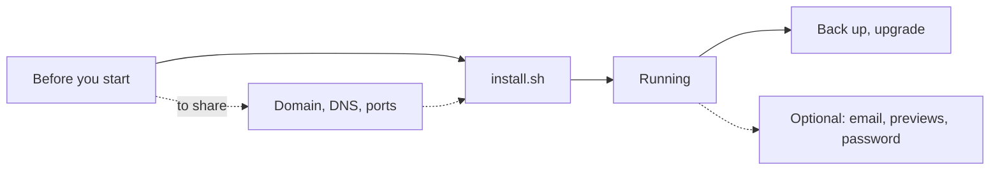
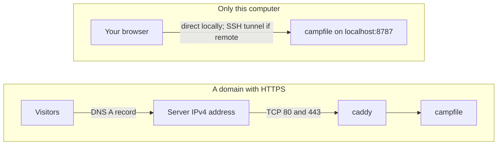
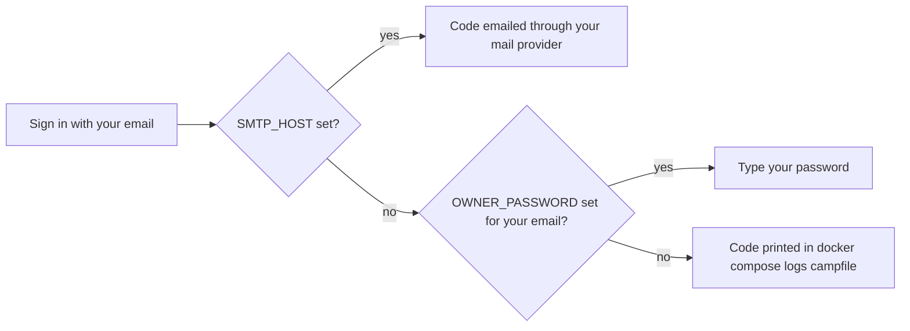
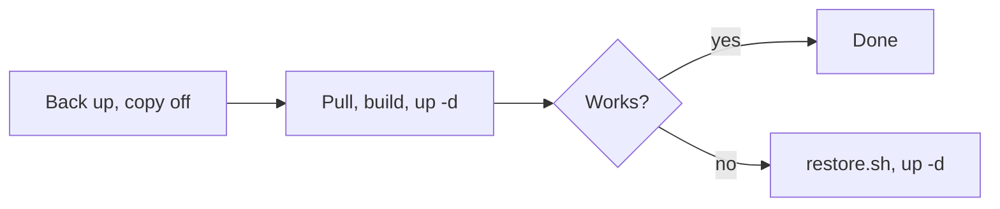

# Run your own Campfile

Install Campfile on your own server with Docker. For external Postgres, a custom proxy, separate domains, account administration, moving to a new server and recovery, use [advanced hosting](DEPLOY-ADVANCED.md).

## Contents

| Section | Covers |
|---|---|
| [Before you start](#before-you-start) | Docker, Git, memory, domain |
| [Install](#install) | `install.sh` |
| [Run, stop, restart](#run-stop-restart) | Daily commands |
| [When it does not work](#when-it-does-not-work) | Common errors |
| [Share through one HTTPS address](#share-through-one-https-address) | Domain, open sign-up |
| [Get outgoing email](#get-outgoing-email) | SMTP provider setup |
| [Link previews](#link-previews) | Screenshots; [turn them off](#without-screenshots) |
| [Sign in with a password](#sign-in-with-a-password-single-user-mode) | Single-user mode |
| [Back up](#back-up) | `backup.sh`, where restoring is explained |
| [Upgrade](#upgrade) | `git pull`, `restore.sh` |
| [Install without install.sh](#install-without-installsh) | Plain `docker compose` |
| [Get an API key](#get-an-api-key) | Scripts and agents |

Setup order; optional parts can come later:



## Before you start

| You need | Details |
|---|---|
| Docker and Git | Docker with Compose 2.20 or newer, and Git. Debian or Ubuntu server: the commands below. Mac: [Docker Desktop](https://docs.docker.com/get-started/get-docker/) and Git. Windows: run everything inside WSL (a Linux system in Windows), as on a Linux server |
| Memory | 2 GB, or 1 GB without [screenshots](#link-previews) |
| Disk | About 5 GB free for Docker with screenshots, 3 GB without, plus room for your pages and backups |

On a Debian or Ubuntu server:

```sh
curl -fsSL https://get.docker.com | sh
sudo apt install -y git
```

Run Campfile as root, or join the `docker` group with `sudo usermod -aG docker $USER` and log in again.

To share pages with other people you also need, before you install:

1. **A domain** you own, such as `pages.example.com`.
2. **A DNS record.** At your DNS host, create one **A** record from that name to the server's public IPv4 address (your provider's dashboard shows it). Delete any **AAAA** record for that name: Campfile listens on IPv4 only. If your DNS host offers a proxy or CDN for the record, turn it off ("DNS only").
3. **Open ports.** In your provider's firewall, allow incoming TCP 80 and 443. UFW on the server does not govern ports Docker publishes, so the provider's firewall is the one that counts.
4. **Wait for DNS.** On the server, `dig +short pages.example.com` must print that address and nothing else (no `dig`? `sudo apt install -y dnsutils`).
5. **Outgoing email**, so other people get their sign-in codes. Ready now: do steps 1 and 2 of [Get outgoing email](#get-outgoing-email), keep the values at hand, and answer `e` at question 3 of `install.sh`. Not ready: answer `p` and add email after installing.

## Install

On the server, in your home folder:

```sh
git clone https://github.com/arica-no/campfile
cd campfile/selfhost
./install.sh
```

It asks four things, writes the answers to `.env`, then starts Campfile if you answer yes to question 4. Enter takes the default:

| Question | Answers | Writes |
|---|---|---|
| 1. Address | Only this computer (Enter), or type a domain for HTTPS | Domain: `APP_ORIGIN`, `COMPOSE_PROFILES=https` |
| 2. Screenshots | Yes (default) or no ([compare them](#link-previews)) | No: `compose.override.yaml` |
| 3. Sign-in | `e`: emailed codes (needs your [SMTP settings](#get-outgoing-email)) | `SMTP_HOST`, `SMTP_PORT` (and `SMTP_USER`, `SMTP_PASSWORD` if you give a user), `EMAIL_FROM`, `ADMIN_EMAIL` |
| | `p` (default): a password only you use ([single-user mode](#sign-in-with-a-password-single-user-mode)) | `OWNER_EMAIL`, `OWNER_PASSWORD` |
| | `l`: codes printed in `docker compose logs campfile` | Nothing |
| 4. Start Campfile now? | Yes (default) or no | No: start later with `docker compose up -d --build` |

If `compose.override.yaml` already exists and you answer no to screenshots, `install.sh` neither writes it nor starts Campfile: [add the lines yourself](#without-screenshots). Answers cannot contain a single quote (`'`).



On a remote server without a domain, run `ssh -L 8787:localhost:8787 <user>@<server>` on your own computer and leave it running; then browse to http://localhost:8787 on that computer. Agents on your computer use the same tunnel.

When it is up, open its address: **Get started** on the home page lists what is left to set up and disappears once every step is ticked. For scripts and agents, [get an API key](#get-an-api-key).

> [!NOTE]
> Change settings by editing `selfhost/.env`, then run `docker compose up -d`. Do not copy `.env.example` over `.env`: that deletes your answers. `install.sh` is for a new install only: it stops if `.env` exists. The everyday settings are explained in `.env.example`; all of them in [Settings reference](DEPLOY-ADVANCED.md#settings-reference).

## Run, stop, restart

Run these in `selfhost/`:

| To | Run |
|---|---|
| See if it is up | `docker compose ps` (campfile shows `healthy`) |
| Read its log | `docker compose logs campfile` |
| Stop it | `docker compose stop` |
| Start it again | `docker compose up -d` |

Which Docker install you have decides two things:

| Docker install | Starts again after a reboot | Caddy on ports 80 and 443 |
|---|---|---|
| Standard, as above | Yes, unless you stopped it with `docker compose stop` | Yes |
| Rootless (a separate install that runs Docker without root) | Only if you configure it to start at boot | No: use the standard install for a domain |

> [!WARNING]
> Page files, connector state, database rows and generated settings live in Docker volumes. Never use `docker compose down -v` unless you intend to delete them.

## When it does not work

| Symptom | Fix |
|---|---|
| The browser cannot connect to http://localhost:8787 on a remote server | That address is on the server. Use the `ssh -L` tunnel under [Install](#install) |
| The domain shows a certificate error, or does not open after two minutes | `docker compose logs caddy` says why. Check `dig +short <your domain>` and the provider's firewall ([Before you start](#before-you-start)) |
| The page does not load, or shows an error | `docker compose ps`, then `docker compose logs campfile` |
| No sign-in email, or "Something went wrong" when you ask for a code | `docker compose logs --since 10m campfile`: the line starting `Error:` is the cause (often a wrong SMTP password). Each failed send still counts toward the limit of 5 codes per email per hour |
| No sign-in email, and the log's `Error:` line says `timeout` | Some cloud hosts block outgoing mail ports on new servers. Try port 2587 (Resend accepts it) or ask your host to unblock 587 |
| Locked out after setting SMTP | Setting `SMTP_HOST` turns password sign-in off. Put a `#` in front of the `SMTP_HOST`, `SMTP_PORT`, `SMTP_USER` and `SMTP_PASSWORD` lines in `.env` (all four: Campfile refuses to start with only some of them) and run `docker compose up -d`; your password works again |
| `429`, or "5 codes were already sent", in single-user mode | You started 5 sign-ins this hour. Wait an hour |
| Every start logs a line beginning `CIMD (Client ID Metadata Document) is disabled`, which reads like an error | Nothing to fix |

## Share through one HTTPS address

> [!WARNING]
> Anyone who finds your address can make an account and publish pages on your domain. There is no switch to stop that.

Do [Before you start](#before-you-start) first. `install.sh` sets this up when you type a domain. To switch an install from this computer to a domain, set these lines in `selfhost/.env`:

```dotenv
APP_ORIGIN=https://pages.example.com
COMPOSE_PROFILES=https
SMTP_HOST=smtp.example.com
SMTP_PORT=587
SMTP_USER=your-smtp-user
SMTP_PASSWORD='your-smtp-password'
EMAIL_FROM=Campfile <signin@example.com>
ADMIN_EMAIL=you@example.com
```

Then run `docker compose up -d --build` and open your HTTPS address. Caddy obtains and renews its certificate. The app and the viewer (which serves shared pages) share it; leave `VIEWER_ORIGIN` empty.

Campfile limits each visitor by IP address. Whether it sees the real address depends on your Docker install:

| Docker | Visitor addresses |
|---|---|
| Standard, on Linux | Sees each visitor's address |
| Rootless, Docker Desktop | May see one address for everyone, so all visitors share limits such as 20 requested emails a day ([operator checks](DEPLOY-ADVANCED.md#check-a-deployment)) |

The admin commands call an account a tester: not the people you send links to. Watch the notices sent to `ADMIN_EMAIL`.

To shut an account out, find its name in the first column of `docker compose exec campfile pnpm admin list-testers` (for someone who signed up, their email). Then run `docker compose exec campfile pnpm admin disable-tester <name>`.

That blocks their sign-in, keys and connectors and takes their pages offline; [Admin](DEPLOY-ADVANCED.md#admin) has the undo. Before hosting other people's accounts, read [operator responsibilities](DEPLOY-ADVANCED.md#hosting-other-peoples-accounts).

Without SMTP, every email is printed in `docker compose logs campfile` instead of sent, on any address. You can sign in with the code from the log (the code screen says so), but nobody else gets a code, an approval or an invitation: set SMTP before you share pages.

Pages run in a browser sandbox, but on one address they are served from the same domain as your Campfile. If people you do not trust can upload, serve pages from a second domain: [a separate viewer site](DEPLOY-ADVANCED.md#separate-viewer-site).

## Get outgoing email

Campfile sends email through an SMTP server: your mail provider's server for sending mail from programs. Use a provider made for that, such as Resend, Postmark, Amazon SES or Mailgun.

Which sign-in your settings give:



With Resend:

1. Create an account and add your domain. Resend shows DNS records (SPF and DKIM) to add at your DNS host: they let it send as your domain.
2. Create an API key.
3. Not installed yet: answer `e` at question 3 of `install.sh` and type these values when it asks. Already installed: set these lines in `selfhost/.env`, then run `docker compose up -d`.

   ```dotenv
   SMTP_HOST=smtp.resend.com
   SMTP_PORT=587
   SMTP_USER=resend
   SMTP_PASSWORD='<your API key>'
   EMAIL_FROM=Campfile <signin@example.com>
   ADMIN_EMAIL=you@example.com
   ```

   `EMAIL_FROM` must be on the domain you added. To try SMTP before adding a domain, Resend's `onboarding@resend.dev` sender works, but only to your own Resend account's email.

   From then on everyone, you included, signs in with an emailed code, and `OWNER_PASSWORD` stops working.
4. Sign in with your email. The code must arrive within a minute; if not, see [When it does not work](#when-it-does-not-work).

## Link previews

A link shared in a chat app shows a screenshot of the page, and so do the page's card in **Your pages** and the spread view (**Manage**, **See how it spread**: who opened it through whose link). The screenshot service takes them: a locked-down browser (headless Chromium) in its own container, which opens each published page and takes its picture.

`docker compose up` starts it unless you turn it off. It shows only pages from your own Campfile; see [its security notes](DEPLOY-ADVANCED.md#link-preview-screenshots).

| | With screenshots | Without |
|---|---|---|
| Shared links, cards, the spread view | A picture of the page | A picture drawn from the page's title |
| When | Within seconds of publishing; pages without one get theirs one at a time, every 10 minutes. Until then, or while the service is busy, links show the title picture | Always the title picture |
| Memory (RAM) | 2 GB; 1 GB works, but a picture of a page with heavy graphics can fail ([measurements](DEPLOY-ADVANCED.md#link-preview-screenshots)) | 1 GB |
| Disk for the programs | about 2.5 GB | about 1.4 GB |
| Security | Opens pages other people wrote in a browser on your server | No browser on your server |

Everything else works the same without it: publishing, sharing, approvals and [AI connectors](../README.md#connect-your-ai). Disk figures are the images' sizes; installing needs extra room while it builds.

### Without screenshots

Turning screenshots off saves about 1.1 GB of disk (the image's Node base stays, since the app uses it too) and the service's memory.

1. Put this in `selfhost/compose.override.yaml`, next to `compose.yaml` (if that file exists already, add these lines to its `services:`):

   ```yaml
   services:
     screenshot:
       profiles: [screenshots] # not started, and not built
     campfile:
       environment:
         SCREENSHOT_URL: '' # no new screenshots: a page without one shows the picture drawn from its title
   ```

2. Run `docker compose up -d --build`.
3. If the service already ran, also run `docker compose rm -sf screenshot` and `docker image rm campfile-screenshot`.

Screenshots already taken stay in use. To turn screenshots back on, delete those lines and run `docker compose up -d --build`.

## Sign in with a password (single-user mode)

For a server only you use, without SMTP: no email and no server log needed to sign in. You choose the password; Campfile never makes or sends one.

1. In `selfhost/.env` (create it if there is none), set:

   ```dotenv
   OWNER_EMAIL=you@example.com
   OWNER_PASSWORD='a password of 12 or more characters'
   ```

   Keep the single quotes: they keep `$` and spaces as typed.
2. Run `docker compose up -d`.
3. Sign in with that email. Where Campfile asks for the code, it shows "Type your password": type `OWNER_PASSWORD`.

The password works wherever a code is asked for: the sign-in page, an AI app's connector (`/mcp`), and an agent's sign-in (`/agents`), where the agent asks you for "the code" ([Connect your AI](../README.md#connect-your-ai)). Only `OWNER_EMAIL` takes it; any other email still needs a code.

To change the password, edit `.env` and run `docker compose up -d`. Two limits apply, both 5:

- 5 wrong passwords in one sign-in. Then start the sign-in again.
- 5 sign-ins an hour for your email. The browser, each AI app and each agent count as one each. A sixth gets `429` until the hour is over, so connect more than five things over two hours.

Setting `SMTP_HOST` turns this mode off: everyone, you included, then signs in with an emailed code, and the startup log warns that `OWNER_PASSWORD` is ignored. Use SMTP as soon as anyone else should sign in; on a domain, anyone can then make an account ([open sign-up warning](#share-through-one-https-address)).

## Back up

Back up **before upgrading**. In `selfhost/`:

```sh
./backup.sh
```

It saves the code, your settings, the database, page files and generated secrets into a new folder under `~/campfile-backup` (or under a folder you give it, outside the checkout: `./backup.sh /var/backups/campfile`), and prints its name. Campfile is stopped for the seconds it takes, then started again if it was running.

To go back to a backup: `./restore.sh <backup folder>`; read [Restore a backup](DEPLOY-ADVANCED.md#restore-a-backup) first. `restore.sh` works only with the Compose project name `campfile`, which a default install uses.

A finished backup's folder holds a file named `complete`. What to do with each folder:

| Folder | Contains `complete` | Do |
|---|---|---|
| A finished backup | Yes | Keep the newest; nothing deletes older ones for you |
| A failed backup (it names the step) | No | Delete it |
| `…-replaced-…`, made by `restore.sh` | No | Keep while you may still [undo a restore](DEPLOY-ADVANCED.md#undo-a-restore) |

`backup.sh` refuses to run while files in the `campfile` folder are changed and not committed (`.env` and `compose.override.yaml` don't count). If you edited files there on purpose, commit them: `git add -A && git commit -m "My changes"`. Before committing on a new server, set who you are: `git config --global user.email you@example.com` and `git config --global user.name "Your Name"`.

> [!WARNING]
> The folder holds every page and your passwords. Keep it private and off this server. From your own computer: `scp -r <user>@<server>:campfile-backup/<folder> .`

For a nightly backup, add a line with `crontab -e`, as the user that runs Docker (change `$HOME/campfile` if you cloned it elsewhere):

```
0 3 * * * $HOME/campfile/selfhost/backup.sh >> $HOME/campfile-backup.log 2>&1
```

Certificate volumes need no backup. External databases and custom Compose files need their own backup procedure in [advanced hosting](DEPLOY-ADVANCED.md).

## Upgrade



1. [Back up](#back-up) and copy the folder off the server; continue only if both succeed.
2. There are no numbered releases: an upgrade takes the newest `main`. To see what it brings first: `git fetch && git log --oneline HEAD..origin/main`. Then, from `selfhost/`:

   ```sh
   git pull --rebase &&
   docker compose pull --ignore-buildable &&
   docker compose build --pull &&
   docker compose up -d
   ```

   If Git reports a conflict in your local edits, resolve it before continuing.
3. New migrations run automatically before requests are served. Check `docker compose ps` and `docker compose logs campfile`, sign in, and open an existing shared page.
4. If it does not work, go back to the backup with `./restore.sh <backup folder>` ([Restore a backup](DEPLOY-ADVANCED.md#restore-a-backup)). It asks before it replaces anything, puts back the matched code, database and files, and leaves Campfile stopped: start it with `docker compose up -d`. Writes since that backup are lost.

> [!WARNING]
> Do not delete volumes or replace generated secrets.

## Install without install.sh

Install Docker with Compose and Git, as in [Before you start](#before-you-start).

```sh
git clone https://github.com/arica-no/campfile
cd campfile/selfhost
docker compose up -d --build
```

Open **http://localhost:8787**. Campfile starts its own Postgres and its screenshot service, generates its passwords and signing secrets once, and applies migrations before serving. The app and shared pages use this one address; no `.env` is needed, create one to change settings.

1. Press **Log in** on the home page and type your email address.
2. Read the local sign-in email with `docker compose logs campfile`; enter its code in the browser.
3. Follow **Get started** on the home page. Public links work on this computer; use [HTTPS](#share-through-one-https-address) to share with other people.

Local email goes to the container log, not an inbox. To sign in with a password you choose instead, use [single-user mode](#sign-in-with-a-password-single-user-mode).

## Get an API key

For an API key to your own workspace (the pages **Your pages** shows), sign in from a terminal. Use your address instead of `http://localhost:8787`:

```sh
curl -sS -X POST http://localhost:8787/api/signin -H "Content-Type: application/json" -d '{"email": "you@example.com"}'
curl -sS -X POST http://localhost:8787/api/signin/verify -H "Content-Type: application/json" -d '{"email": "you@example.com", "code": "<code>"}'
```

The code is the one emailed to you or printed in `docker compose logs campfile`; in single-user mode, it is your password (one with `'`, `"` or `\` needs escaping in that command). Send `verify` within 5 minutes of `signin`, or run `signin` again.

The answer's `key` is your API key: keep it private.

Other keys. A workspace is one account (the commands call it a tester), and `<name>` is its name:

| To | Run |
|---|---|
| List workspaces and their names | `docker compose exec campfile pnpm admin list-testers` |
| Make a separate workspace with its own key | `docker compose exec campfile pnpm admin add-tester <name>` |
| Join it to your email (only before that email's first sign-in; refused after) | `docker compose exec campfile pnpm admin set-email <name> you@example.com` |
